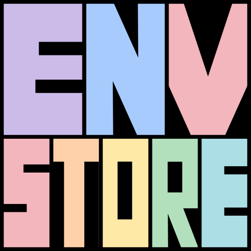

<p align="center">
  
</p>

<h1 align="center">Environment store</h1>

Store and manage environment variables persistently, in a hierarchy, on different backends: a local file,
PostgreSQL, AWS Parameter Store or AWS Secrets Manager. Use it from **Python**, the **command line** or an
interactive **terminal UI**.

- **Hierarchical:** organisation > project > environment > service. Child levels override their parents.
- **Pluggable backends:** the same API, CLI and TUI for every store, and a `transfer` command to move between them.
- **Three interfaces:** `EnvironmentStoreManager` in Python, the `environment-store` CLI, and a Textual-based TUI.
- **Agent friendly:** ships a [skill](.claude/skills/environment-store-cli/SKILL.md) that teaches LLM agents to use the CLI safely.

```
root                      LOG_LEVEL=info
└── acme                  (organisation)       DB_HOST=db.acme.internal
    └── webapp            (project)
        └── prod          (environment)        LOG_LEVEL=warning
            └── api       (service)            PORT=8080
```

The resolved variables of `acme / webapp / prod / api` are all of the above combined, deeper values winning:
`DB_HOST=db.acme.internal`, `LOG_LEVEL=warning`, `PORT=8080`.

## Quickstart

```bash
uv add "environment-store[tui]"        # or: pip install "environment-store[tui]"

export ENVIRONMENT_STORE_BACKEND=json ENVIRONMENT_STORE_JSON_FILE=./store.json

environment-store set LOG_LEVEL info
environment-store set PORT 8080 -o acme -p webapp -e prod -s api
environment-store list -o acme -p webapp -e prod -s api --resolved
environment-store tui
```

```python
from environment_store import EnvironmentStoreManager
from environment_store.adapters.json import JsonFileAdapter

manager = EnvironmentStoreManager(adapter=JsonFileAdapter("./store.json"))
manager.set_variable("DB_HOST", "localhost", organisation="acme", project="webapp")
manager.get_resolved_variables(organisation="acme", project="webapp")
```

The full walkthrough is in the **[Quickstart](docs/quickstart.md)**.

## Documentation

| Guide | |
|---|---|
| [Quickstart](docs/quickstart.md) | five minutes from install to your first variables |
| [Installation](docs/installation.md) | extras, uv, pip, git, `uvx` |
| [Python usage](docs/python-usage.md) | the `EnvironmentStoreManager` API |
| [Command line interface](docs/cli.md) | all commands, `transfer`, exit codes, recipes |
| [Terminal UI](docs/tui.md) | layout and key bindings |
| [Storage backends](docs/backends.md) | JSON, PostgreSQL, Parameter Store, Secrets Manager |
| [Development](docs/development.md) | setup, architecture, tests, contributing |
| [Adding a storage adapter](docs/adding-an-adapter.md) | developer guide for new backends |

### Installation

The core package depends only on `pydantic` and includes the JSON backend and the CLI. Everything else is an extra:

| Extra | Adds |
|---|---|
| `aws` | AWS Parameter Store and Secrets Manager backends (boto3) |
| `postgres` | PostgreSQL backend and `migrate` (psycopg, sqlalchemy, yoyo-migrations) |
| `tui` | the terminal UI ([Textual](https://textual.textualize.io/)) |
| `full` | all of the above |

```bash
uv add "environment-store[full]"
```

More, including installing from git and running without installing, in the [installation guide](docs/installation.md).

### Python

Everything goes through `EnvironmentStoreManager`; only the adapter changes per backend. Pass the hierarchy as
keyword arguments (`organisation=`, `project=`, `environment=`, `service=`); levels cannot be skipped.

```python
manager.set_variables({"LOG_LEVEL": "INFO"}, organisation="acme")
manager.get_variable("DB_HOST", organisation="acme", project="webapp")  # exact level
manager.get_resolved_variables(organisation="acme", project="webapp")  # with parent levels
manager.get_child_levels(organisation="acme")  # ["webapp"]
manager.delete_level(organisation="acme", project="webapp", confirm="webapp")
```

Reading, writing, resolving, discovering, deleting and copying are covered in the
[Python guide](docs/python-usage.md).

### Command line

```bash
environment-store set DB_HOST localhost -o acme -p webapp
environment-store get DB_HOST -o acme -p webapp
environment-store list -o acme --resolved --format json
environment-store import .env -o acme -p webapp -e dev
environment-store delete-level -o acme -p webapp --dry-run
environment-store transfer --dest-backend postgres --dest-database-url "$URL" --dry-run
environment-store migrate            # PostgreSQL schema
```

Commands: `get`, `set`, `list`, `delete`, `import`, `children`, `delete-level`, `transfer`, `migrate`, `tui`.
Choose the backend with `--backend` or `ENVIRONMENT_STORE_BACKEND`. Data goes to stdout, messages to stderr, and
exit codes are stable. See the [CLI guide](docs/cli.md) for every option.

### Terminal UI

```bash
environment-store tui
```

A tree of your levels next to a table of their variables. Navigate with the arrow keys or `hjkl`; `a` add, `e` edit,
`d` delete, `n` new level, `x` delete a level (you must type its name), `r` resolved view, `v` show values,
`q` quit. See the [TUI guide](docs/tui.md).

### Storage backends

| Backend | `--backend` | Stores |
|---|---|---|
| JSON file | `json` | one local file |
| PostgreSQL (15+) | `postgres` | one row per variable; run `environment-store migrate` first |
| AWS Parameter Store | `ssm` | one parameter per variable |
| AWS Secrets Manager | `secretsmanager` | one secret per level |

Options, IAM permissions, layouts and trade-offs are in [Storage backends](docs/backends.md).

### Development

```bash
uv sync && pre-commit install
uv run pytest && uv run ruff check && uv run ty check
```

The CLI, the TUI and any future frontend are thin layers over `EnvironmentStoreManager`; all logic lives in
`environment_store/core/`. Architecture, testing, adding features and adapters, and database migrations are in the
[development guide](docs/development.md). To add a new storage backend follow
[Adding a storage adapter](docs/adding-an-adapter.md).

## License

MIT, see [LICENSE](LICENSE).
