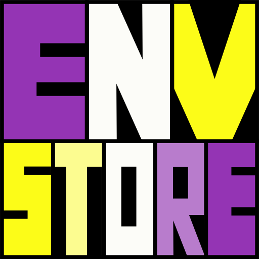

<p align="center">
  
</p>

<h1 align="center">Environment Store</h1>

Environment Store keeps your environment variables in **named stores**: flat collections of `NAME=value`
pairs such as `base`, `dev`, `prod` or `customer-a`. Stores live in a backend you pick with a connection string:
JSON or TOML files in a directory, a SQLite file, or a PostgreSQL database. Any store can be encrypted as a whole
with AES-256-GCM, using a key file or a passphrase. You use the stores from the `envs` command line tool, from
Python with one function call, or from a terminal UI. An
[agent skill](https://github.com/mkaufhol/environment-store/blob/main/.claude/skills/environment-store-cli/SKILL.md)
teaches coding agents how to drive the CLI safely.

> **Version 2.0 is in development (`2.0.0.dev0`) and not on PyPI yet.** `pip install environment-store` currently
> installs the old 0.1 line, which has no `envs` command. Until 2.0 is released, install it from a clone of the
> repository as shown below;
> [Installation](https://github.com/mkaufhol/environment-store/blob/main/docs/installation.md) has the details.

## The CLI in 30 seconds

Install from a clone (Python 3.13 or newer):

```console
$ git clone https://github.com/mkaufhol/environment-store.git && cd environment-store
$ git switch feature/v2
$ python3.13 -m venv .venv && . .venv/bin/activate
$ pip install -e '.[cli]'
$ envs --version
environment-store 2.0.0.dev0
```

Then, in any directory:

```console
$ export ENV_STORE_CONNECTION=json://.envs        # keep the stores as JSON files in ./.envs

$ envs create-store base
created store 'base'
$ envs set -s base DB_HOST=localhost DB_PORT=5432 LOG_LEVEL=info
set DB_HOST, DB_PORT, LOG_LEVEL in store 'base'
$ envs create-store dev
created store 'dev'
$ envs set -s dev DB_HOST=dev.example.com DEBUG=true
set DB_HOST, DEBUG in store 'dev'

$ envs ls -v --source base dev                    # later stores win
DB_HOST=dev.example.com  dev
DB_PORT=5432             base
DEBUG=true               dev
LOG_LEVEL=info           base

$ envs run base dev -- sh -c 'echo "$DB_HOST:$DB_PORT debug=$DEBUG"'
dev.example.com:5432 debug=true

$ envs export base dev -f .env
exported to '.env'
```

## Python in 5 lines

```python
import os
import environment_store

environment_store.load("base", "dev", connection="json://.envs")
print(os.environ["DB_HOST"])  # dev.example.com
```

`load()` works like `load_dotenv()`: it merges the stores and puts the variables into `os.environ`. Variables that
are already set are kept unless you pass `overwrite=True`.

## Features

- **Named, layered stores.** Combine `base` + `dev` + `customer-a` in one call; the last store wins, or the first
  with `--first-wins`. `--source` shows which store each value comes from.
- **Four backends, one interface.** `json://dir`, `toml://dir`, `sqlite:///file.db`, `postgresql://host/db`. Move
  or copy a store between backends with `envs mv-store` / `envs cp-store --to`.
- **Optional encryption per store.** AES-256-GCM with a random key file or an Argon2id passphrase. Names and
  values are encrypted together. Keys are never stored, cached or accepted as literal command line text.
- **Load anywhere.** `envs run` starts a command with the variables, `eval "$(envs export-shell ...)"` loads them
  into a POSIX shell, `envs export` writes dotenv, JSON or TOML, and `environment_store.load()` fills `os.environ`.
- **Safe dotenv files.** Exported `.env` files read back exactly with both python-dotenv and Docker Compose; values
  that cannot be written safely are refused with a clear hint instead of being written wrong.
- **Project file.** A `.envstore.toml` in your project names the connection, the default stores and the key files,
  so `envs run -- ./manage.py runserver` is all you type.
- **Scriptable.** Data on stdout, messages on stderr, `--json` output, stable exit codes and `--noinput` for CI.
- **Terminal UI.** `envs tui` lets you browse stores and add, edit and delete variables, with values masked and
  each screen's keys in its footer.

## Documentation

| Guide | What it covers |
|---|---|
| [Quickstart](https://github.com/mkaufhol/environment-store/blob/main/docs/quickstart.md) | From install to plain and encrypted stores, `.env` export, `envs run` and Python, in ten minutes |
| [Installation](https://github.com/mkaufhol/environment-store/blob/main/docs/installation.md) | Installing from source today, pip/uv/uvx once 2.0 is on PyPI, the optional extras, entry points |
| [CLI reference](https://github.com/mkaufhol/environment-store/blob/main/docs/cli.md) | Every command and option, with examples |
| [Python library](https://github.com/mkaufhol/environment-store/blob/main/docs/python.md) | `load()`, `EnvironmentStore`, `Environment`, keys and errors |
| [Configuration](https://github.com/mkaufhol/environment-store/blob/main/docs/configuration.md) | Connection strings, `.envstore.toml`, environment variables, merge order |
| [Encryption and keys](https://github.com/mkaufhol/environment-store/blob/main/docs/encryption.md) | Key files, passphrases, `rekey`, `encrypt`, decrypting with `cp-store --plain` |
| [Terminal UI](https://github.com/mkaufhol/environment-store/blob/main/docs/tui.md) | `envs tui` screens and key bindings |
| [Agent skill](https://github.com/mkaufhol/environment-store/blob/main/.claude/skills/environment-store-cli/SKILL.md) | Instructions for coding agents that use the `envs` CLI |

The links in this README are absolute so that they also work on PyPI. The
[documentation index](https://github.com/mkaufhol/environment-store/blob/main/docs/README.md) lists the guides by task.

## Contributing

- What 2.0 does: [SPEC-V2.md](https://github.com/mkaufhol/environment-store/blob/main/SPEC-V2.md)
- How it is built: [IMPLEMENTATION-PLAN.md](https://github.com/mkaufhol/environment-store/blob/main/IMPLEMENTATION-PLAN.md)
- How to contribute (binding rules: TDD, typing, 100 % coverage):
  [CONTRIBUTING.md](https://github.com/mkaufhol/environment-store/blob/main/CONTRIBUTING.md)

## License

MIT, see [LICENSE](https://github.com/mkaufhol/environment-store/blob/main/LICENSE).
